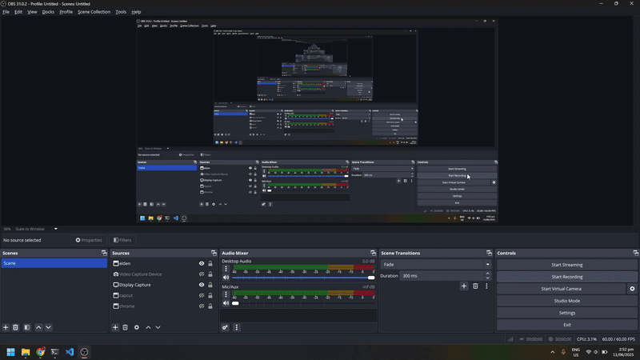

# Only jobs

- Job listing platform

- Recommends related jobs for the job seeker based on their skills

## Tech Stack and Version

- **Laravel 11.x**

- **PHP 8.2**

- **mysql 8.0.41**

- **ReactJS**

## Features

- In app messaging with the use of Pusher for real time updates

- Notifications to notify job seekers on their application status

- Admin Panel

## How to Run the project

1. Clone repository `git clone https://github.com/bakaraw/OnlyJobsWeb.git`
2. Navigate to the project directory `cd OnlyJobsWeb`
3. Copy the environment file `cp env.sample .env`
4. pdate the `.env` file with your credentials:
   - Set `DB_PASSWORD` to match your docker-compose.yml
   - Set `VITE_PUSHER_APP_KEY` and `VITE_PUSHER_APP_CLUSTER` (get from [pusher.com](https://pusher.com))
5. Build and start all containers `docker compose up -d --build`
6. Wait for all 4 containers to be running `docker compose ps`
7. Visit the app at `http://localhost:8000`

## Daily Usage

- **Start** `docker compose up -d`
- **Stop** `docker compose down`
- **View logs** `docker compose logs -f`

## Requirements
- Docker Engine
- Docker Compose
